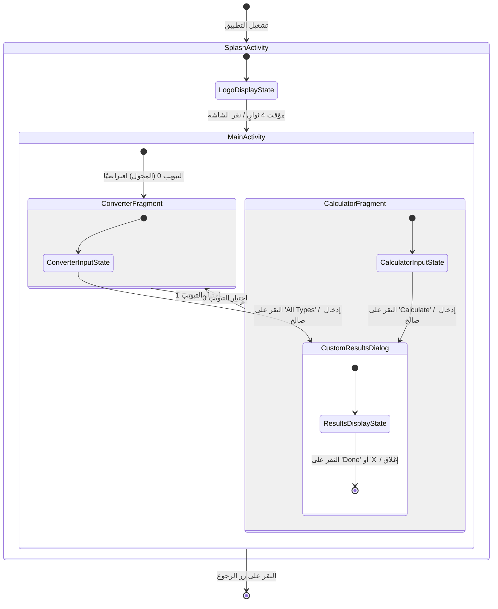
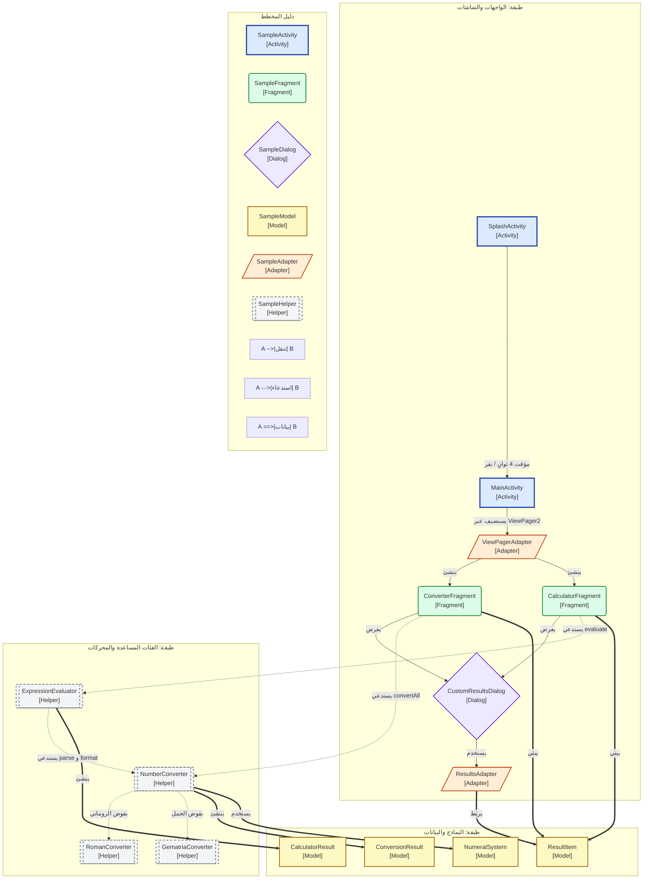

# مخطط التنقل والحالات وخريطة الفئات

## 1. المخطط 1: التنقل والحالات

---

## 2. المخطط 2: خريطة الفئات والعلاقات

---

## 3. كيفية قراءة المخططات

### كيفية قراءة المخطط 1 (الحالات والتنقل)

| العنصر | المعنى |
|---|---|
| `[*]` | نقطة البداية (تشغيل التطبيق) أو النهاية (الخروج). |
| `مربع الحالة` | شاشة أو نافذة معروضة للمستخدم حالياً. |
| `سهم الانتقال` | حدث أو مؤقت ينقل التطبيق من حالة لأخرى. |
| `نص الانتقال` | الحدث أو الشرط المسبب للانتقال (مثل "مؤقت 4 ثوانٍ"). |

---

## 4. أسئلة للاختبار الذاتي

1. **سؤال المؤقت:** كم ثانية تعرض شاشة البدء بشكل افتراضي قبل الانتقال لـ `MainActivity`؟
2. **سؤال الهندسة المعمارية:** ما هي الفئة المساعدة المسؤولة عن حساب التعابير الرياضية مثل `XII + IX`؟
3. **سؤال السلوك:** ماذا يحدث إذا نُقر على الشاشة أثناء عرض الشعار في `SplashActivity`؟
4. **سؤال الفئات:** ما الفرق بين فئة النموذج (`ResultItem`) والفئة المساعدة (`RomanConverter`)؟
