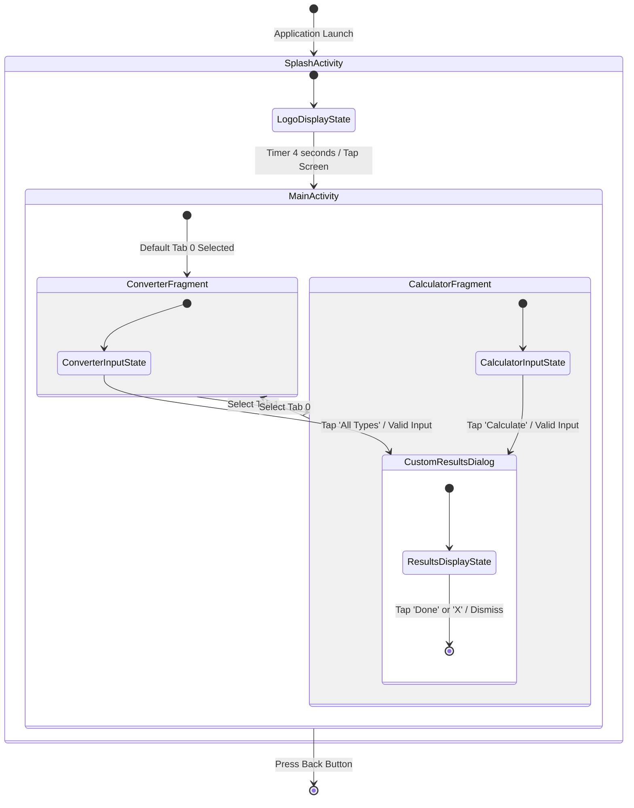
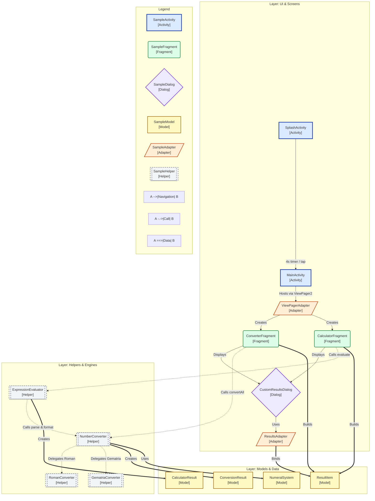

# State Navigation and Class Dependency Map Explained

## 1. Diagram 1: Navigation and State Diagram



---

## 2. Diagram 2: Class & Dependency Map



---

## 3. How to Read the Diagrams

### How to Read Diagram 1 (State & Navigation)

| Element in Diagram | What It Means |
|---|---|
| `[*]` | Start point (app launch) or end point (app exit). |
| `State Box` | A screen or dialog currently visible to the user. |
| `State Transition Arrow` | User action or timer moving the app from one state to another. |
| `Transition Label` | The event or condition triggering the transition (e.g., "Timer 4 seconds"). |
| `Composite State` | A parent container screen (e.g. `MainActivity`) holding internal states/tabs. |

### How to Read Diagram 2 (Class Map)

| Element in Diagram | What It Means | Shape & Color | Project Class Example |
|---|---|---|---|
| **Activity** | Screen container initialized by Android OS | Rectangle `[ ]`, Solid Blue | `SplashActivity`, `MainActivity` |
| **Fragment** | Reusable modular screen section | Rounded `( )`, Green | `ConverterFragment`, `CalculatorFragment` |
| **Dialog** | Floating modal bottom sheet dialog | Diamond `{ }`, Purple | `CustomResultsDialog` |
| **Model / POJO** | Data holding class or Enum | Rectangle `[ ]`, Yellow | `ResultItem`, `NumeralSystem`, `ConversionResult` |
| **Data** | Data persistence layer (DB/Preferences) | Cylinder `[( )]`, Pink | (N/A — App processes data in-memory) |
| **Adapter** | Bridge connecting data to UI lists | Parallelogram `[/ /]`, Orange | `ViewPagerAdapter`, `ResultsAdapter` |
| **Helper / Engine** | Logic, math calculation, and validation engine | Subroutine `[[ ]]`, Dashed Gray | `NumberConverter`, `RomanConverter`, `ExpressionEvaluator` |
| **System** | Built-in Android framework classes | Rectangle `[ ]`, Light Gray Dashed | `Intent`, `Bundle`, `ViewPager2` |
| **Solid Arrow `-->`** | Navigation or creation relationship | Arrow | `SplashActivity --> MainActivity` |
| **Dashed Arrow `-.->`** | Method call or dependency relationship | Dashed | `ConverterFragment -.-> NumberConverter` |
| **Bold Arrow `==>`** | Data creation or binding flow | Bold | `NumberConverter ==> ConversionResult` |

---

## 4. Detailed Explanation

### 1. Core Idea
At any given moment, an application is in exactly one state (e.g., displaying the splash screen, showing the converter, or presenting the results dialog). An event (such as a timer expiring or a button tap) transitions the application to another state. In theoretical computer science, this model is called a **Finite State Machine (FSM)**.

### 2. Everyday Analogy
Think of an **elevator system**:
- The elevator can be in states: `Idle at Floor 1`, `Moving Up`, or `Doors Open`.
- Pressing a button (event) transitions it from `Idle` to `Moving Up`.
- Arriving at the target floor (condition) transitions it from `Moving Up` to `Doors Open`.

### 3. Application Startup Sequence
1. The app starts at `[*]` and launches `SplashActivity`.
2. `SplashActivity` presents the logo for 4000 milliseconds (4 seconds).
3. If the user taps the screen before 4 seconds, or when the timer expires, the app navigates to `MainActivity` and finishes `SplashActivity`.

### 4. Inner Life of MainActivity
- `MainActivity` acts as a parent composite state hosting two tabs: `ConverterFragment` (Tab 0) and `CalculatorFragment` (Tab 1).
- Switching tabs transitions between `ConverterFragment` and `CalculatorFragment`.
- In `ConverterFragment`, tapping "All Types" validates input (1–3999) and opens `CustomResultsDialog`.
- In `CalculatorFragment`, tapping "Calculate" validates the math expression and opens `CustomResultsDialog`.
- Tapping "Done" or "X" in `CustomResultsDialog` dismisses the dialog and returns to the input fragment.

### 5. Class Map Architecture
- **UI Layer:** Contains `SplashActivity`, `MainActivity`, `ConverterFragment`, `CalculatorFragment`, `CustomResultsDialog`, `ViewPagerAdapter`, and `ResultsAdapter`.
- **Helpers Layer:** Contains `NumberConverter`, `RomanConverter`, `GematriaConverter`, and `ExpressionEvaluator`. These classes contain zero Android UI dependencies and perform pure math logic.
- **Model Layer:** Contains `NumeralSystem` (enum), `ResultItem`, `ConversionResult`, and `CalculatorResult`.

### 6. Connection to Java Code

#### Navigation Example (Intent):
```java
// In SplashActivity.java:
navigateRunnable = () -> {
    startActivity(new Intent(SplashActivity.this, MainActivity.class));
    finish();
};
handler.postDelayed(navigateRunnable, 4000);
```

#### Helper Call Example:
```java
// In ConverterFragment.java calling NumberConverter.java:
ConversionResult result = NumberConverter.convertAll(inputText, selectedSystem);
```

### 7. Why Draw Two Diagrams?
- **Diagram 1 (State Diagram)** shows **Behavior**: what the user experiences over time.
- **Diagram 2 (Class Map)** shows **Structure**: how the Java source code files depend on and call each other.
Together, they provide a complete 360-degree understanding of the software.

### 8. Common Student Mistakes
1. **Diagram 1:** Mixing helper classes (like `NumberConverter`) as state boxes instead of keeping states purely as user-visible screens.
2. **Diagram 2:** Conflating Fragments with Activities or forgetting to categorize Helper classes separately from UI controllers.

---

## 5. Self-Test Questions

1. **Timer Question:** How many seconds does the splash screen display by default before navigating to `MainActivity`?
2. **Architecture Question:** Which helper class is responsible for evaluating mathematical expressions like `XII + IX`?
3. **Behavior Question:** What happens if the user taps the screen while `SplashActivity` is displaying the logo?
4. **Range Question:** What is the valid number range supported by `NumberConverter` and why?
5. **Class Map Question:** What is the difference between a Model class (like `ResultItem`) and a Helper class (like `RomanConverter`)?
