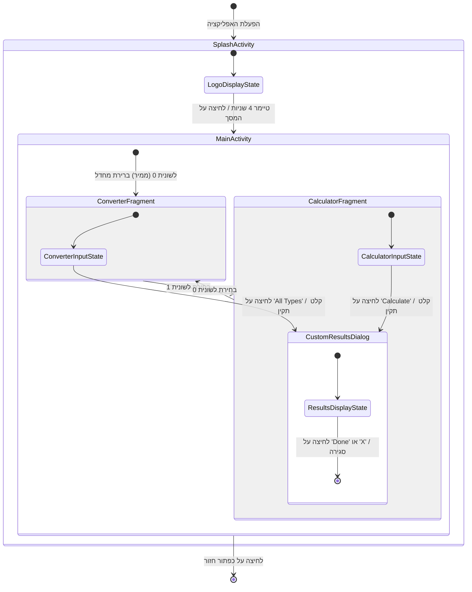
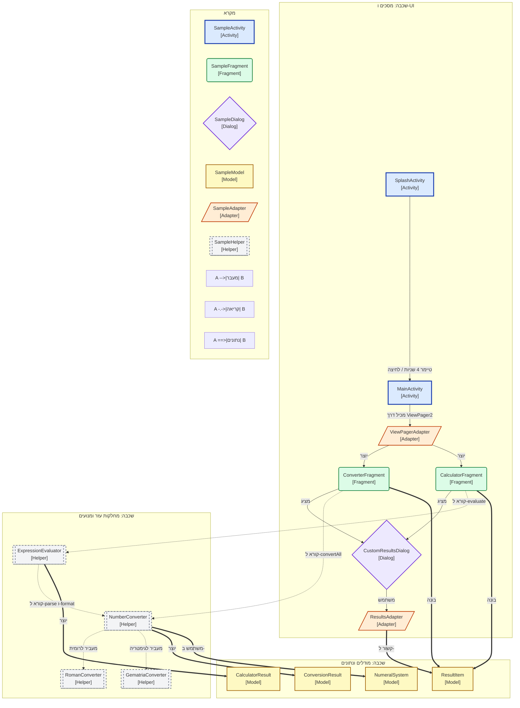

# דיאגרמת ניווט ומצבים ומפת מחלקות וקשרים

## 1. דיאגרמה 1: ניווט ומצבים

---

## 2. דיאגרמה 2: מפת מחלקות וקשרים

---

## 3. איך לקרוא את הדיאגרמות

### איך לקרוא את דיאגרמה 1 (ניווט ומצבים)

| אלמנט בדיאגרמה | מה זה אומר |
|---|---|
| `[*]` | נקודת התחלה (הפעלת האפליקציה) או סיום (יציאה). |
| `מצב (State)` | מסך או דיאלוג המוצג למשתמש ברגע נתון. |
| `חץ מעבר` | אירוע או טיימר המעביר את האפליקציה ממצב אחד לאחר. |
| `כיתוב מעבר` | האירוע או התנאי המפעיל (למשל, "טיימר 4 שניות"). |
| `מצב מורכב` | מסך קונטיינר (כמו `MainActivity`) המכיל מצבים פנימיים/לשוניות. |

### איך לקרוא את דיאגרמה 2 (מפת מחלקות)

| אלמנט בדיאגרמה | מה זה אומר | צורה וצבע | דוגמה מפרויקט זה |
|---|---|---|---|
| **Activity** | מסך קונטיינר המופעל על ידי אנדרואיד | מלבן `[ ]`, כחול | `SplashActivity`, `MainActivity` |
| **Fragment** | רכיב מסך מודולרי | מלבן מעוגל `( )`, ירוק | `ConverterFragment`, `CalculatorFragment` |
| **Dialog** | חלון דיאלוג צף בתחתית המסך | מעוין `{ }`, סגול | `CustomResultsDialog` |
| **Model / POJO** | מחלקת נתונים או Enum | מלבן `[ ]`, צהוב | `ResultItem`, `NumeralSystem`, `ConversionResult` |
| **Data** | שכבת אחסון (בסיס נתונים/הגדרות) | צילינדר `[( )]`, ורוד | (אין — העיבוד מבוצע בזיכרון) |
| **Adapter** | מקשר בין נתונים לרשימת UI | מקבילית `[/ /]`, כתום | `ViewPagerAdapter`, `ResultsAdapter` |
| **Helper / Engine** | מנוע לוגיקה, חישוב ואימות | תת-תוכנית `[[ ]]`, אפור מקווקו | `NumberConverter`, `RomanConverter`, `ExpressionEvaluator` |
| **System** | מחלקות מובנות של אנדרואיד | מלבן `[ ]`, אפור-בהיר מקווקו | `Intent`, `Bundle`, `ViewPager2` |
| **חץ מלא `-->`** | ניווט או יצירת אובייקט | חץ רגיל | `SplashActivity --> MainActivity` |
| **חץ מקווקוו `-.->`** | קריאה למתודה / שימוש | חץ מקווקוו | `ConverterFragment -.-> NumberConverter` |
| **חץ מודגש `==>`** | יצירה או העברת נתונים | חץ מודגש | `NumberConverter ==> ConversionResult` |

---

## 4. הסבר מפורט

### 1. הרעיון המרכזי
בכל רגע נתון האפליקציה נמצאת בדיוק במצב אחד (למשל, מציגה את הלוגו, מציגה את הממיר או מציגה את חלון התוצאות). אירוע (כמו טיימר או לחיצה) מעביר אותה למצב אחר. במדעי המחשב מודל זה נקרא **אוטומט סופי (Finite State Machine - FSM)**.

### 2. אנלוגיה יומיומית
תחשבו על **מעלית**:
- המעלית נמצאת במצבים: `עומדת בקומה 1`, `זזה למעלה`, `דלתות פתוחות`.
- לחיצה על כפתור (אירוע) מעבירה אותה מ-`עומדת` ל-`זזה`.
- הגעה לקומה (תנאי) מעבירה אותה מ-`זזה` ל-`דלתות פתוחות`.

### 3. הפעלת האפליקציה
1. האפליקציה מתחילה ב-`[*]` ומפעילה את `SplashActivity`.
2. `SplashActivity` מציגה את הלוגו במשך 4 שניות (4000 מילישניות).
3. אם המשתמש לוחץ על המסך לפני חלוף 4 השניות או כשהטיימר מסתיים, האפליקציה עוברת ל-`MainActivity` וסוגרת את `SplashActivity`.

---

## 5. שאלות לבדיקה עצמית

1. **שאלת זמן:** כמה שניות מוצג מסך הפתיחה כברירת מחדל לפני מעבר ל-`MainActivity`?
2. **שאלת ארכיטקטורה:** איזו מחלקת עזר אחראית על חישוב ביטויים מתמטיים כמו `XII + IX`?
3. **שאלת התנהגות:** מה קורה אם המשתמש לוחץ על המסך בזמן הצגת הלוגו ב-`SplashActivity`?
4. **שאלת טווח:** מהו טווח המספרים התקין הנתמך ב-`NumberConverter` ומדוע?
5. **שאלת מפת מחלקות:** מה ההבדל בין מחלקת מודל (`ResultItem`) למחלקת עזר (`RomanConverter`)?
