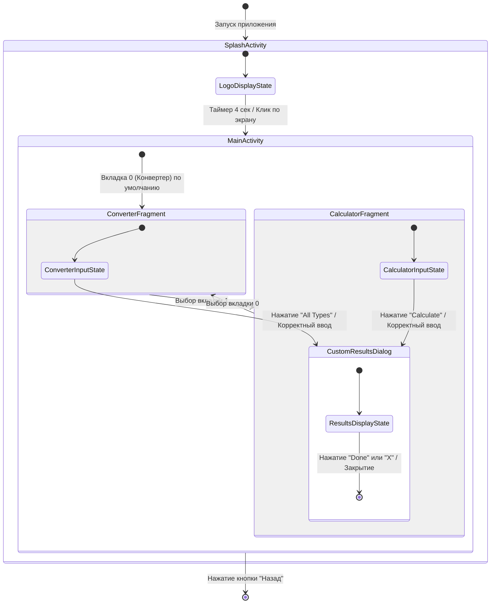
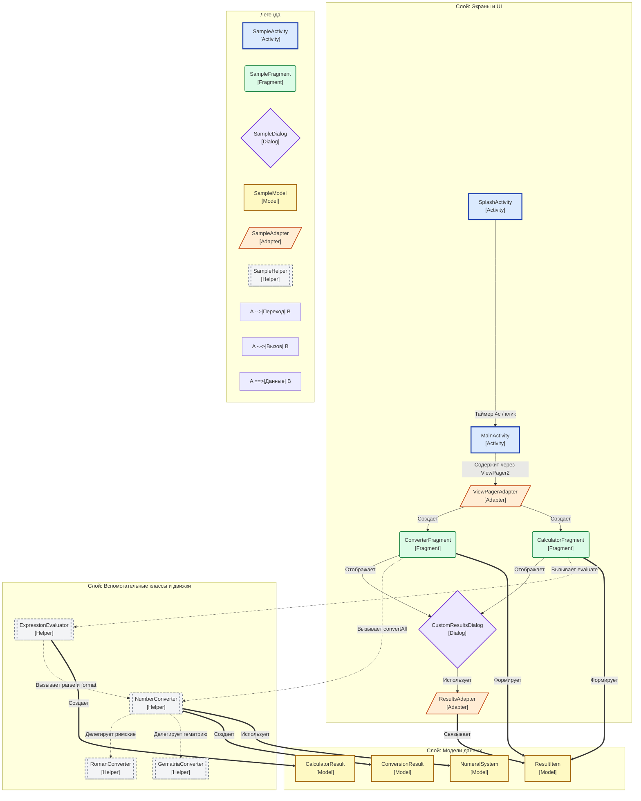

# Диаграмма навигации состояний и карта классов

## 1. Диаграмма 1: Навигация и состояния

---

## 2. Диаграмма 2: Карта классов и связей

---

## 3. Как читать диаграммы

### Как читать Диаграмму 1 (Состояния и навигация)

| Элемент | Что означает |
|---|---|
| `[*]` | Точка старта (запуск) или завершения (выход) приложения. |
| `Блок состояния` | Экран или диалог, видимый пользователю в данный момент. |
| `Стрелка перехода` | Действие пользователя или таймер, переводящий приложение в другое состояние. |
| `Метка перехода` | Событие или условие перехода (например, "Таймер 4 сек"). |
| `Составное состояние` | Главный экран-контейнер (например, `MainActivity`), содержащий внутренние состояния/вкладки. |

### Как читать Диаграмму 2 (Карта классов)

| Элемент | Что означает | Форма и цвет | Пример класса проекта |
|---|---|---|---|
| **Activity** | Экран-контейнер, инициализируемый Android OS | Прямоугольник `[ ]`, Синий | `SplashActivity`, `MainActivity` |
| **Fragment** | Переиспользуемый модуль экрана | Закругленный `( )`, Зеленый | `ConverterFragment`, `CalculatorFragment` |
| **Dialog** | Всплывающий нижний диалог | Ромб `{ }`, Фиолетовый | `CustomResultsDialog` |
| **Model / POJO** | Класс данных или Enum | Прямоугольник `[ ]`, Желтый | `ResultItem`, `NumeralSystem`, `ConversionResult` |
| **Data** | Слой хранения (БД / SharedPreferences) | Цилиндр `[( )]`, Розовый | (Н/Д — данные обрабатываются в памяти) |
| **Adapter** | Мост между данными и списком UI | Параллелограмм `[/ /]`, Оранжевый | `ViewPagerAdapter`, `ResultsAdapter` |
| **Helper / Engine** | Логика, математика, конвертация | Подпрограмма `[[ ]]`, Серый пунктир | `NumberConverter`, `RomanConverter`, `ExpressionEvaluator` |
| **System** | Встроенные классы Android Framework | Прямоугольник `[ ]`, Светло-серый пунктир | `Intent`, `Bundle`, `ViewPager2` |
| **Сплошная стрелка `-->`** | Навигация или создание | Стрелка | `SplashActivity --> MainActivity` |
| **Пунктирная стрелка `-.->`** | Вызов метода или связь | Пунктир | `ConverterFragment -.-> NumberConverter` |
| **Жирная стрелка `==>`** | Создание или передача данных | Жирная | `NumberConverter ==> ConversionResult` |

---

## 4. Подробное объяснение

### 1. Главная идея
В любой момент времени приложение находится ровно в одном состоянии (например, отображает логотип, показывает конвертер или открывает диалог с результатами). Событие (таймер или нажатие кнопки) переводит приложение в другое состояние. В теоретической информатике эта модель называется **Конечным Автоматом (Finite State Machine - FSM)**.

### 2. Бытовая аналогия
Представьте **лифт**:
- Лифт может находиться в состояниях: `Стоит на 1 этаже`, `Движется вверх`, `Двери открыты`.
- Нажатие кнопки (событие) переводит его из `Стоит` в `Движется`.
- Прибытие на этаж (условие) переводит его из `Движется` в `Двери открыты`.

### 3. Запуск приложения
1. Приложение стартует с `[*]` и открывает `SplashActivity`.
2. `SplashActivity` показывает логотип 4 секунды (4000 мс).
3. Если пользователь нажимает на экран раньше 4 секунд или по истечении таймера, происходит переход на `MainActivity`, а `SplashActivity` закрывается (`finish()`).

### 4. Внутренняя жизнь MainActivity
- `MainActivity` содержит две вкладки: `ConverterFragment` (вкладка 0) и `CalculatorFragment` (вкладка 1).
- Переключение вкладок меняет состояние между конвертером и калькулятором.
- Нажатие "All Types" в конвертере проверяет ввод и открывает `CustomResultsDialog`.
- Нажатие "Calculate" в калькуляторе вычисляет выражение и открывает `CustomResultsDialog`.
- Нажатие "Done" или "X" закрывает диалог.

### 5. Архитектура классов
- **UI:** `SplashActivity`, `MainActivity`, `ConverterFragment`, `CalculatorFragment`, `CustomResultsDialog`, `ViewPagerAdapter`, `ResultsAdapter`.
- **Helpers:** `NumberConverter`, `RomanConverter`, `GematriaConverter`, `ExpressionEvaluator` (чистая логика без UI).
- **Models:** `NumeralSystem` (enum), `ResultItem`, `ConversionResult`, `CalculatorResult`.

---

## 5. Вопросы для самопроверки

1. **Вопрос по таймеру:** Сколько секунд отображается загрузочный экран по умолчанию?
2. **Вопрос по архитектуре:** Какой класс вычисляет математические выражения вида `XII + IX`?
3. **Вопрос по поведению:** Что произойдет, если нажать на экран во время показа логотипа на `SplashActivity`?
4. **Вопрос по диапазону:** Какой допустимый диапазон чисел поддерживается приложением и почему?
5. **Вопрос по карте классов:** В чем разница между классом Модели (`ResultItem`) и классом Helper (`RomanConverter`)?
